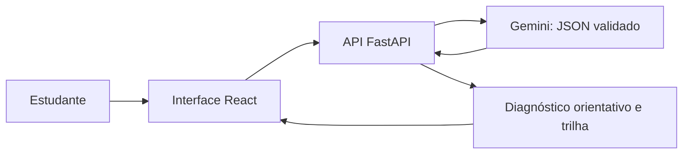

<p align="center"></p>

# SkillBridge

  

Ilustração conceitual acima; não é screenshot. **Repositório acadêmico em planejamento**, sem aplicação implementada nesta etapa.

Orientação profissional para universitários buscando o primeiro emprego: a proposta é usar IA para apoiar a compreensão das competências declaradas e recomendar trilhas de aprendizagem. Alinhado à **ODS 8 — Trabalho Decente e Crescimento Econômico**. Não oferece certificação, diagnóstico profissional definitivo ou emprego garantido.

[📋 Project nº 2](https://github.com/users/PedroGiffoni/projects/2) · [🧩 Issues](https://github.com/PedroGiffoni/SkillBridge-UNIFOR/issues) · [📚 Backlog](docs/gestao-projeto/backlog.md)

## Sumário

[Proposta](#proposta) · [Stack e arquitetura](#stack-e-arquitetura-planejadas) · [Gestão](#gestão-do-projeto) · [Instalação e configuração](#instalação-e-configuração) · [Testes e publicação](#testes-e-publicação) · [Limitações](#limitações-e-próximos-passos)

## Proposta

Fluxo planejado: formação acadêmica → profissão desejada → questionário de competências → análise orientativa → possíveis lacunas → trilha de aprendizagem → dashboard. Esses recursos são escopo futuro, não funcionalidades entregues.

## Stack e arquitetura planejadas

| Camada | Tecnologias propostas |
| --- | --- |
| Front-end | React, TypeScript, Vite, Tailwind CSS |
| API | Python, FastAPI, Pydantic |
| IA | Gemini API, SDK oficial google-genai, modelo gratuito a confirmar na conta |
| Dados | SQLite somente se necessário ao MVP |
| Visualização | Recharts |
| Testes | Pytest e Playwright |
| Ambiente | Git, GitHub, VS Code e Codex |



Arquitetura proposta; não representa sistema em execução. Identidade visual prevista: SaaS profissional, azul profundo/violeta, interface responsiva, acessibilidade e motion discreto com movimento reduzido. Three.js é opcional, condicionado ao prazo e desempenho.

## Gestão do projeto

| Sprint | Período planejado | Escopo | Issues |
| --- | --- | --- | --- |
| 1 | 11–14/11/2026 | Planejamento, requisitos e protótipos | 8 |
| 2 | 15–20/11/2026 | MVP, IA e testes técnicos | 10 |
| 3 | 21–26/11/2026 | Validação e relatório | 8 |

Entrega F108 — Universidade de Fortaleza: **27/11/2026, Dream Shape**. Datas acima não comprovam execução. Equipe e responsáveis aguardam confirmação.

- [Backlog completo](docs/gestao-projeto/backlog.md)
- [Sprints, dependências e equipe](docs/gestao-projeto/planejamento-sprints.md)
- [Fluxo Kanban](docs/gestao-projeto/quadro-kanban.md)
- [Critérios de conclusão](docs/gestao-projeto/criterios-de-conclusao.md)
- [Registro da configuração e limitações](docs/gestao-projeto/registro-configuracao.md)
- [Auditoria das 26 Issues](docs/gestao-projeto/verificacao.json)
- [Sprint 1](docs/gestao-projeto/sprint-01/planejamento.md), [Sprint 2](docs/gestao-projeto/sprint-02/planejamento.md), [Sprint 3](docs/gestao-projeto/sprint-03/planejamento.md)

Cada sprint contém planejamento, relatório com execução pendente e diretório para evidências reais.

## Instalação e configuração

Para consultar a documentação, basta Git ou a interface web do GitHub:

```powershell
git clone https://github.com/PedroGiffoni/SkillBridge-UNIFOR.git
cd SkillBridge-UNIFOR
```

Não há dependências de aplicação, servidores ou comandos de execução disponíveis neste repositório. SB-09 definirá versões, instalação reproduzível, estrutura técnica e `.env.example`. Planeja-se `GEMINI_API_KEY` exclusivamente no backend e `GEMINI_MODEL` configurável; não versionar chaves, arquivos `.env` ou dados pessoais. A disponibilidade gratuita deve ser confirmada na implementação.

## Testes e publicação

Nenhum teste de aplicação foi executado neste repositório: ainda não há código. SB-18 prevê testes técnicos com Pytest/Playwright. SB-19 a SB-24 planejam validação com pelo menos 10 usuários reais, cinco ou mais evidências autorizadas, métricas e gráficos baseados em dados coletados. Não existem resultados de pesquisa nesta etapa.

Não houve deploy desta aplicação nesta etapa. Hospedagem, comandos e URL serão definidos e documentados com base na implementação real. A entrega acadêmica exige relatório, revisão, PDF/anexos e submissão no Dream Shape.

## Estrutura

```text
docs/
  assets/                      # Ilustração conceitual
  gestao-projeto/
    backlog.md
    planejamento-sprints.md
    quadro-kanban.md
    criterios-de-conclusao.md
    sprint-01/                 # planejamento, relatório e evidências
    sprint-02/
    sprint-03/
```

## Limitações e próximos passos

Somente gerenciamento e documentação foram preparados. Priority, Start date e Target date são campos locais do Project nº 2, preenchidos nas 26 Issues; datas representam planejamento. Não há aplicação, deploy, métricas ou participantes comprovados neste repositório. Confirmar equipe e capacidade, revisar SB-01 a SB-08 e realizar as atividades com evidências reais. Para contribuir, referenciar a Issue correspondente e aplicar os critérios de conclusão. Licença ainda não definida.
